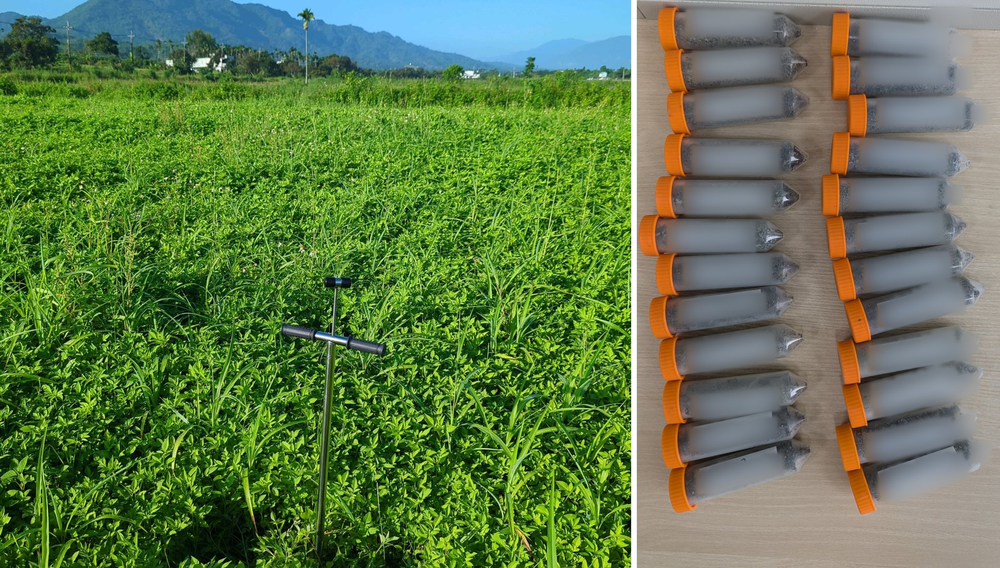

In September 2025 the barrier lake on the Mataian River burst and buried the farmland of Guangfu, Hualien, under silt. One year on, CTS News returned for a special report, "Guangfu Township, one year later", and our soil work is part of it. The story covers NCKU's three-year Hualien Science Station, which brings agriculture, hydraulics, engineering and medicine to the recovery.

<iframe style="position:absolute; top:0; left:0; width:100%; height:100%; border:0;" src="https://www.youtube-nocookie.com/embed/nf4D9ySnVlY?rel=0&start=2312&end=3053" title="CTS News: Guangfu Township, one year later" loading="lazy" allow="accelerometer; autoplay; clipboard-write; encrypted-media; gyroscope; picture-in-picture; web-share" referrerpolicy="strict-origin-when-cross-origin" allowfullscreen></iframe>

The question we work on is simple: when is a buried field ready to be farmed again? The Hualien District Agricultural Research and Extension Station leads the fertilizing and tilling, and the first corn harvest on treated plots is in the report. A field that looks tidy is not proof, so we measure it. We sample every field in two layers, the new silt on top and the original soil underneath, and read the microbial community by ONT sequencing, next to the physical and chemical tests.

The goal is one simple index: green to plant, yellow to wait, red not yet.

Our segment runs from 38:32 to 50:53. Thanks to the CTS team, the farmers of Guangfu, and our partners at the Hualien station. More clips are on the [Media coverage](/media) page.

華視新聞高峰會報導：馬太鞍溪堰塞湖潰堤一週年。

2025年9月，馬太鞍溪堰塞湖潰堤，花蓮光復鄉的農地被泥沙掩埋。一年後，華視新聞高峰會製作專題「光復鄉的這一年」，我們的土壤研究也在其中。報導介紹成大為期三年的「花蓮科學工作站」，結合農業、水利、工程與醫療，一起投入災後復原。

我們想回答的問題很單純：被掩埋的農地，什麼時候可以再種？花蓮區農業改良場負責第一線的施肥與翻耕，報導中也拍到改良後田區收成的玉米。不過田看起來整理好了，不代表真的可以種，所以需要數據。我們取樣每塊田，分為上層淤泥層和底下的原土，使用ONT平台定序看微生物相，搭配土壤的物理化學檢測。

目標是整理成一個簡單易懂的指標，綠燈可以種，黃燈再等等，紅燈還不適合。

我們的片段在38:32到50:53。謝謝華視團隊、光復的農友，還有花蓮區農業改良場的夥伴。其他報導請見[Media coverage](/media)頁面。
