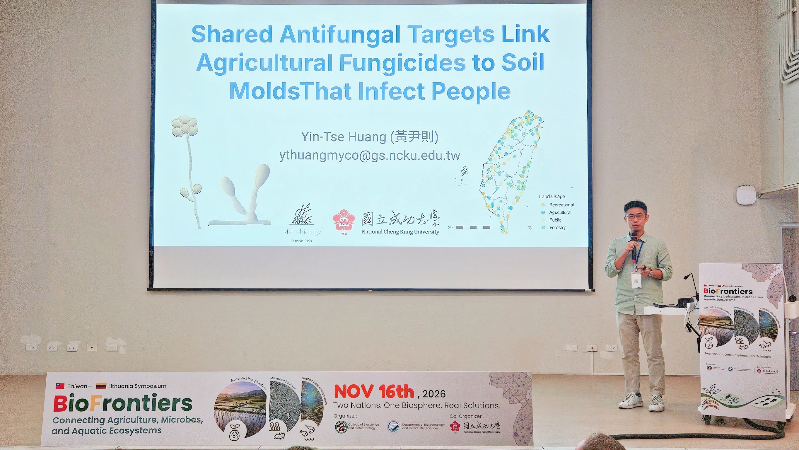
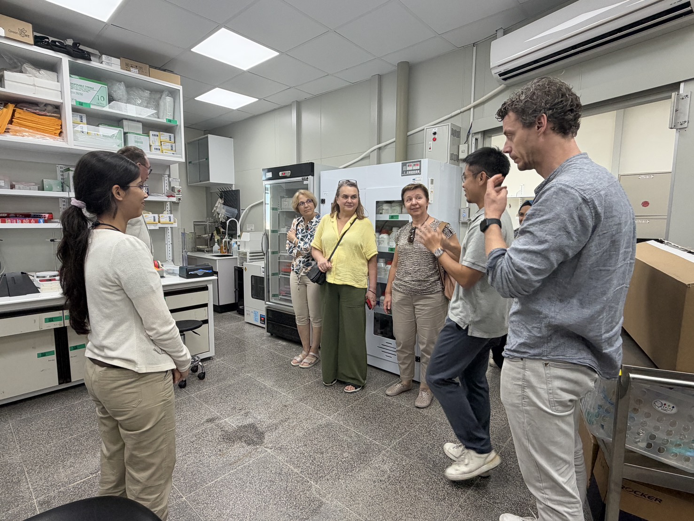
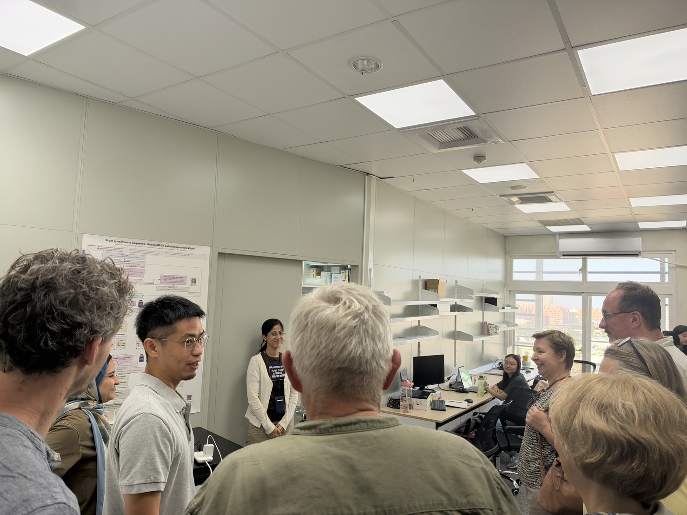

On November 16, NCKU hosted the 2026 Taiwan–Lithuania Symposium, "BioFrontiers: Connecting Agriculture, Microbes, and Aquatic Ecosystems", with speakers from Vilnius University and the Nature Research Centre in Lithuania. Yin-Tse spoke in the Biocontrol in Agriculture session. His talk, "Shared Antifungal Targets Link Agricultural Fungicides to Soil Molds That Infect People", asked whether fungicide use on farms shapes drug resistance in *Scedosporium* and *Lomentospora*, drawing on our nationwide soil survey.

The next day the Lithuanian delegation came to the MEGA Lab. We showed them the bench space and our specimen-to-sequence Nanopore workflow, and they met the lab members. Killer yeasts, mycoviruses and antifungal resistance turned out to have plenty in common, and we hope this is the start of a collaboration. Thank you for visiting, and see you in Vilnius!

台灣–立陶宛雙邊研討會與實驗室參訪。

11月16日，成大舉辦2026 Taiwan–Lithuania Symposium「BioFrontiers: Connecting Agriculture, Microbes, and Aquatic Ecosystems」，立陶宛維爾紐斯大學與自然研究中心的學者來台交流。尹則在「Biocontrol in Agriculture」場次報告，題目是「Shared Antifungal Targets Link Agricultural Fungicides to Soil Molds That Infect People」，用我們全台土壤調查的資料，討論農用殺菌劑是否影響賽多孢子菌（*Scedosporium*）和*Lomentospora*的抗藥性。

隔天立陶宛的老師們來MEGA Lab參觀。我們介紹了實驗室空間，還有從樣本到序列的Nanopore流程，也讓大家和實驗室成員聊聊。殺手酵母、真菌病毒和抗藥性真菌，其實有很多可以一起做的題目，期待之後的合作。謝謝來訪，維爾紐斯見！
